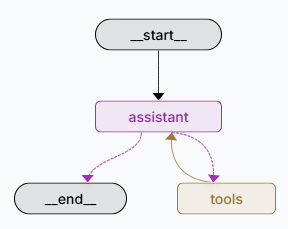

.. _ai_utilities:

AI Utils
========

Installation and configuration
------------------------------

Make sure to install the required libraries for the chosen method. For SpaCy, Sentence Transformers or OpenAI LLM, you
can install them with the following command:

.. code-block:: bash

    pip install toolium[ai]

DeepEval has a separate optional extra so that its pytest plugins are only installed when explicitly requested:

.. code-block:: bash

    pip install "toolium[deepeval]"

This extra requires DeepEval >=3.9.9,<3.10.0. To use all AI utilities, install "toolium[ai,deepeval]".

**Additional Requirements:**

For SpaCy, you also need to download the language model, i.e. for small English model:

.. code-block:: bash

    python -m spacy download en_core_web_sm

For OpenAI LLM, you need to set up your configuration using environment variables or include it in the Toolium configuration.
The required parameters will vary depending on your access type (direct OpenAI or Azure OpenAI):

.. code-block:: bash

    # For example, to configure direct OpenAI access:
    OPENAI_API_KEY=<your_api_key>

.. code-block:: bash

    # For example, to configure Azure OpenAI:
    AZURE_OPENAI_API_KEY=<your_api_key>
    AZURE_OPENAI_ENDPOINT=<your_endpoint>
    OPENAI_API_VERSION=<your_api_version>

*[AI]* section::

[AI]
# If you are using Azure OpenAI
azure_api_key: your-azure-api-key
azure_endpoint: https://your-endpoint.azure.com
api_version: 2025-01-01-preview
azure_deployment: gpt-4o-mini
azure_temperature: 0.7 # Optional Temperature for OpenAI model, between 0 and 1.
# If you are using OpenAI directly
openai_api_key: your-openai-api-key
openai_temperature: 0.7 # Optional Temperature for OpenAI model, between 0 and 1.

Different AI providers can be used in the same project.

Text Similarity
---------------

Text similarity is a measure of how alike two pieces of text are in terms of meaning, structure, or content.
Toolium provides several methods to compare and validate text similarity using different AI techniques:

1. `SpaCy <https://spacy.io/>`_: Uses the SpaCy library to compute text similarity with pre-trained NLP models. Fast,
lightweight and good for general-purpose text analysis.

2. `Sentence Transformers <https://github.com/UKPLab/sentence-transformers>`_: Leverages Sentence Transformers for
semantic textual similarity using deep learning embeddings. Best balance of accuracy and performance for semantic
similarity.

3. `OpenAI <https://github.com/openai/openai-python>`_: Utilizes OpenAI's language models for advanced semantic text
comparison. Provides the most sophisticated analysis but requires API access and it may incur costs.

4. `DeepEval <https://deepeval.com/>`_: Provides additional semantic similarity and LLM-as-a-Judge metrics. It is optional and does not change the existing methods or defaults.

See :ref:`deepeval_utilities` for usage, metric options and configuration.

Usage
~~~~~

You can use the function `assert_text_similarity` from `toolium.utils.ai_utils.text_similarity` module to compare
two texts using any of these methods. You can specify the method to use with the `similarity_method` parameter and set a
threshold for similarity with the `threshold` parameter (a value between 0 and 1, where 1 means identical and 0 means
completely different).

.. code-block:: python

    from toolium.utils.ai_utils.text_similarity import assert_text_similarity

    # Basic usage
    input_text = "The quick brown fox jumps over the lazy dog"
    expected_text = "A fast brown fox leaps over a sleepy dog"  # Admits both a single expected text or a list of expected texts
    threshold = 0.8  # Similarity threshold between 0 and 1
    similarity_method = 'spacy'  # Options: 'spacy', 'sentence_transformers', 'openai', 'azure_openai'

    # Validate similarity
    assert_text_similarity(input_text, expected_text, threshold=threshold, similarity_method=similarity_method)

Configuration
~~~~~~~~~~~~~

Default similarity method can be set in the properties.cfg file with the property *text_similarity_method* in
*[AI]* section::

    [AI]
    text_similarity_method: openai  # Options: 'spacy' (default), 'sentence_transformers', 'openai', 'azure_openai'
    spacy_model: en_core_web_lg  # SpaCy model to use, en_core_web_sm by default
    sentence_transformers_model: all-MiniLM-L6-v2  # Sentence Transformers model to use, all-mpnet-base-v2 by default
    openai_model: gpt-3.5-turbo  # OpenAI model to use, gpt-4o-mini by default
    provider: openai  # AI provider: 'openai' (default) or 'azure'

To select models for each method, you can refer to the following links:

* `SpaCy models <https://spacy.io/models>`_
* `Sentence Transformers models <https://github.com/UKPLab/sentence-transformers>`_
* `OpenAI models <https://platform.openai.com/docs/models>`_

.. _deepeval_utilities:

DeepEval evaluation
-------------------

Use `toolium.utils.ai_utils.deepeval` explicitly; it does not change existing similarity methods or defaults.
DeepEval provides reusable metrics, evaluation criteria and explanations. The existing OpenAI utilities instead use
Toolium prompts and response parsing, including their Pydantic response contracts. Local SpaCy and Sentence Transformers
methods remain useful for fast comparisons without provider calls. DeepEval requires model access and can incur costs;
it does not guarantee better accuracy. Calibrate thresholds with positive, borderline and negative examples for each
metric and model rather than copying thresholds from another method.

Prefer the response and conversation APIs below for a consistent result contract. Individual metric functions remain
available as shortcuts; their return values are described under :ref:`deepeval_shortcuts`.

Responses and conversations
~~~~~~~~~~~~~~~~~~~~~~~~~~~

Toolium supports independent single-turn and multi-turn evaluations. A response evaluation builds an `LLMTestCase`;
a conversation evaluation builds a `ConversationalTestCase` from explicit user/assistant turns. Toolium does not collect
messages or retain scenario history. A scenario may evaluate one response during the interaction and the conversation
at its end.

Both APIs return `{"results": {metric_name: {"score": ..., "reason": ..., "passed": ...}}, "passed": ...}`.
Only selected metrics run, and every selected metric must pass. Assertions use the same decision without measuring
again. Evaluation errors propagate; they are not converted into successful or fabricated scores.

.. code-block:: python

    from toolium.utils.ai_utils.deepeval import (
        evaluate_response_with_deepeval,
        assert_conversation_with_deepeval,
    )

    response_result = evaluate_response_with_deepeval(
        input_text="Where is my order?",
        actual_output="It is ready for pickup.",
        retrieved_context=["The order is ready for pickup."],
        metric_config={
            "answer_relevancy": {"threshold": 0.7},
            "faithfulness": {"threshold": 0.8},
        },
    )
    messages = [
        {"role": "user", "content": "Where is my order?"},
        {"role": "assistant", "content": "It is ready for pickup."},
        {"role": "user", "content": "Is it being delivered?"},
        {"role": "assistant", "content": "No, you need to collect it."},
    ]
    assert_conversation_with_deepeval(
        messages,
        metric_config={
            "turn_relevancy": {"threshold": 0.7},
            "knowledge_retention": {"threshold": 0.8},
        },
    )

Response metric names are `answer_relevancy`, `faithfulness`, `contextual_relevancy`, `contextual_precision`,
`contextual_recall`, `toxicity`, `pii_leakage`, `hallucination`, `json_correctness`, `tool_correctness`, `text_similarity`,
`answer_correctness` and `geval`. Supply each metric's required case fields (for example `expected_output`,
`tools_called`, `expected_tools`) and constructor options (for example `expected_schema` inside `metric_config`).
Custom `geval` requires `criteria` or `evaluation_steps`; `evaluation_params` can select its case fields.

For evidence, reference facts and JSON inputs, see :ref:`deepeval_context_inputs`.

Conversation metric names are `turn_relevancy`, `knowledge_retention`, `conversation_completeness` and
`conversational_geval`. Messages may be dictionaries or DeepEval `Turn` objects, with `user` or `assistant` roles.
Additional case options such as `scenario` and `expected_outcome` are accepted. Single-turn metrics cannot be used
in conversation evaluations or vice versa. `assert_response_with_deepeval()` and `assert_conversation_with_deepeval()`
fail with details of all failed selected metrics. Without `metric_config`, the defaults are `answer_relevancy` for
responses and `turn_relevancy` for conversations, each with threshold `0.7`.

Judge creation and reuse
~~~~~~~~~~~~~~~~~~~~~~~~

Every evaluation function accepts `model=judge`, including the individual getters and assertions. A supplied model is
used directly, without consulting the default driver wrapper or creating another model. Do not combine it with
`provider`, `model_name` or non-empty `model_kwargs`. Models created directly through DeepEval are also accepted.
Without an injected model, standalone functions create a model for that invocation.

.. code-block:: python

    from toolium.utils.ai_utils.deepeval import create_deepeval_model, DeepEvalEvaluator

    judge = create_deepeval_model(provider="azure", temperature=0.0)
    evaluator = DeepEvalEvaluator(
        model=judge,
        metric_config={"faithfulness": {"threshold": 0.8}},
        conversation_metric_config={"turn_relevancy": {"threshold": 0.7}},
    )
    result = evaluator.evaluate_response(
        "Where is my order?", "Ready for pickup.", retrieved_context=["Ready for pickup."],
    )
    evaluator.assert_conversation(messages)
    evaluator.assert_summary("The order is ready for pickup.", "Order ready for pickup.", threshold=0.7)

`create_deepeval_model()` resolves [DeepEval], [AI] and defaults as described below. Pass `config=your_config_parser`
to avoid the default driver wrapper. Without `model`, `DeepEvalEvaluator` creates a judge once at construction and
accepts the same model configuration options. It keeps copies of response and conversation metric definitions.

Each call creates fresh metrics and a fresh case, and returns a separate result. Supplying `metric_config` to an
evaluator method replaces its defaults for that call only; it does not merge with or modify the stored selection.
The evaluator retains no conversation, last result or metric instances. It offers `evaluate_response`,
`evaluate_conversation`, `evaluate_summary` and corresponding `assert_*` methods.

With Behave, the evaluator can be prepared in `before_all`, and each scenario supplies its own messages. With pytest,
a session fixture can serve the same purpose. Multiple processes each own their evaluator. Concurrent threads may
share an evaluator only if its judge supports concurrent calls, whether injected or created by Toolium; otherwise
use a separate judge and evaluator per thread.
Toolium isolates metric and case state but does not add locking to third-party models. Configure the default wrapper
before starting concurrent evaluations; do not mutate shared configuration during model creation.

GEval rubrics
~~~~~~~~~~~~~

Similarity, answer correctness and the default conversational GEval use explicit steps versioned in Toolium's source.
Text-characteristic analysis builds explicit steps for each requested characteristic. This avoids the additional LLM
request to generate steps for those defaults; it does not make LLM verdicts deterministic.

Pass `evaluation_steps=[...]` to customize the rubric. For similarity and answer correctness, custom `criteria` without
`evaluation_steps` lets DeepEval generate matching steps instead of applying the default rubric. The same rule applies
to custom `geval` and `conversational_geval` metric configurations. In characteristic analysis use `text_criteria` for
the characteristics; optional `evaluation_steps` are applied to each selected characteristic.

Metrics and options
~~~~~~~~~~~~~~~~~~~

Every `metric_config` entry requires a `threshold` between 0 and 1. Empty selections are rejected.
Options are forwarded to the corresponding DeepEval metric; unsupported options are rejected by its constructor.
Toolium uses the metric's native `is_successful()` decision, including `strict_mode`.

* `faithfulness`: checks that answer claims are supported by `retrieved_context`.
* `contextual_relevancy`: checks the relevance of retrieved evidence to the question.
* `contextual_precision`: checks the ranking of relevant evidence against `expected_output`.
* `contextual_recall`: checks whether evidence covers `expected_output`.
* `toxicity` and `hallucination`: lower scores are better; the threshold is the maximum acceptable score.
* `pii_leakage`: higher scores indicate better privacy protection; 1.0 means no detected leakage.
* `json_correctness`: requires `expected_schema` in the metric options.
* `tool_correctness`: requires `tools_called` and `expected_tools` as case fields. By default only tool names are
  compared; set `evaluation_params=[ToolCallParams.INPUT_PARAMETERS, ToolCallParams.OUTPUT]` in the metric options
  to compare arguments and output as well. Either field may be selected independently.

Higher scores are better for contextual, similarity, correctness and summarization metrics. Contextual precision and
recall require `expected_output`; similarity and answer correctness use it as the reference answer.

The four contextual metrics support `include_reason` (default `True`), `async_mode` (default `True`), `strict_mode`
(default `False`), `verbose_mode` (default `False`) and `evaluation_template`. Faithfulness also accepts
`truths_extraction_limit` and `penalize_ambiguous_claims`. For example::

    metric_config={
        "faithfulness": {"threshold": 0.7, "truths_extraction_limit": 10, "penalize_ambiguous_claims": True},
        "contextual_recall": {"threshold": 0.8, "include_reason": True},
    }

Set `async_mode=False` where synchronous execution is required. Available options vary for other metrics.
Keep the judge outside `metric_config`: use top-level `model=judge`, or `provider`, `model_name` and `model_kwargs`.

Contextual shortcut
~~~~~~~~~~~~~~~~~~~

`evaluate_contextual_with_deepeval()` selects only the four contextual metrics and returns the same result contract
as the response API. Use `metric_config` as above, or select `metrics="faithfulness"` (the default) or a list of names.
With `metrics`, `threshold` may be one number (default 0.7) or a mapping of metric names to thresholds; omitted mapping
entries use 0.7. `metric_kwargs` supplies common metric options. Do not combine these settings with `metric_config`.
`assert_contextual_with_deepeval()` raises `AssertionError` if any selected metric fails.

.. _deepeval_context_inputs:

Evidence, reference facts and JSON inputs
~~~~~~~~~~~~~~~~~~~~~~~~~~~~~~~~~~~~~~~~~

`retrieved_context` supplies retrieved evidence for faithfulness and contextual metrics.
`reference_context` supplies reference facts for hallucination. If `reference_context` is omitted or `None`,
the retrieved evidence is also used as the hallucination reference. An explicit empty list remains empty.
Both parameters accept a single string or dictionary, or a list containing strings or
JSON-compatible objects/arrays. A list represents separate context items; to use a JSON array
as one item, wrap it in an outer list (for example `retrieved_context=[["ready", "pickup"]]`).
Toolium reserves `context` for Behave context; it is not accepted as an evaluation argument.
The mapping to DeepEval's internal `context` field is handled by Toolium.

.. code-block:: python

    response_result = evaluate_response_with_deepeval(
        input_text="Where is my order?",
        actual_output="It is ready for pickup.",
        retrieved_context=["The order is ready for pickup."],
        reference_context=[{"order_status": "ready", "delivery": "pickup"}],
        metric_config={
            "faithfulness": {"threshold": 0.8},
            "hallucination": {"threshold": 0.2},
        },
    )

Dictionaries and nested lists are serialized with `ensure_ascii=False` and indentation; strings remain unchanged.
The same normalization applies to contextual and individual faithfulness/hallucination functions. For several API
responses, use one object per item, such as `[order_response, customer_response]`. Combine LLM evaluation with
deterministic assertions for exact identifiers, amounts, dates and statuses.

Summaries against source text
~~~~~~~~~~~~~~~~~~~~~~~~~~~~~

Summarization is a separate operation: DeepEval expects the original document in `input` and the summary in
`actual_output`. A question or instruction such as "Summarize the document" is not the source text. It is not a metric
in `evaluate_contextual_with_deepeval()` or `evaluate_response_with_deepeval()`.

.. code-block:: python

    from toolium.utils.ai_utils.deepeval import (
        get_summarization_with_deepeval,
        assert_summarization_with_deepeval,
    )

    source_text = "Order 12345 is ready for pickup. Its total is 49.99 EUR."
    summary = "Order 12345 is ready for pickup and costs 49.99 EUR."
    score, reason = get_summarization_with_deepeval(
        source_text=source_text,
        summary=summary,
        threshold=0.75,
        n=5,
        assessment_questions=["Does it include the order status?", "Does it preserve the total?"],
        truths_extraction_limit=10,
    )
    assert_summarization_with_deepeval(source_text, summary, threshold=0.75)

A higher summary score is better. `n` controls the number of generated assessment questions; `assessment_questions`
provides explicit questions, and `truths_extraction_limit` limits extracted facts. Other options are passed to
`SummarizationMetric`. For JSON sources, serialize the source into one string before calling this API.

.. _deepeval_shortcuts:

Individual metric shortcuts
~~~~~~~~~~~~~~~~~~~~~~~~~~~

The `get_*_with_deepeval` functions evaluate one metric; matching `assert_*_with_deepeval` functions return `None` on
success and raise `AssertionError` on native metric failure. They accept `model=judge` and metric-specific options.

* `get_text_similarity_with_deepeval(text, expected_text)` returns a float. Its assertion accepts a string or a list
  in `expected_texts` and succeeds if any reference passes.
* `get_answer_evaluation_with_deepeval(llm_answer, reference_answer, question=...)` returns `(score, reason)`.
  Its assertion accepts `reference_answers` and succeeds if any reference passes.
* Summarization, PII leakage, toxicity, tool correctness, contextual recall/precision/relevancy, JSON correctness,
  hallucination and faithfulness getters return `(score, reason)`.
* `get_text_criteria_analysis_with_deepeval(text_input, text_criteria)` returns `overall_match` (informational mean),
  `features` (failed characteristics with scores and explanations) and `passed`. Every characteristic must pass;
  a high mean does not compensate for a failure. Empty criteria are rejected.

.. code-block:: python

    from toolium.utils.ai_utils.deepeval import assert_text_criteria_with_deepeval

    assert_text_criteria_with_deepeval(
        text_input="The deployment is complete and all checks passed.",
        text_criteria=["clear message", "deployment status is included"],
        threshold=0.7,
    )

DeepEval configuration
~~~~~~~~~~~~~~~~~~~~~~

DeepEval resolves each setting independently, in this order:

1. Explicit function arguments (`provider`, `model_name` and options in `model_kwargs`).
2. The key in the `[DeepEval]` section.
3. The same key in the `[AI]` section, if absent from `[DeepEval]`.
4. The evaluator default, if absent from both sections.

Configuration keys keep their existing names, without a `deepeval_` prefix:

* `provider`: `openai` (default) or `azure`.
* `openai_model`: evaluator model name (default `gpt-4o-mini`), for either provider.
* `openai_api_key` and `openai_temperature`: OpenAI credentials and temperature.
* `azure_api_key`, `azure_endpoint`, `api_version` and `azure_deployment`: Azure connection settings.
* `azure_temperature`: Azure evaluator temperature.

The provider is resolved first, then its credentials and temperature. Temperature defaults to `0.0` when absent from
both sections. A configured zero is preserved. Credentials and Azure connection settings default to `None`, allowing
DeepEval's own environment-based configuration. Azure deployment defaults to the resolved model name.

For example, share the agent connection while overriding the evaluator model and temperature::

    [AI]
    provider: azure
    openai_model: agent-model
    azure_temperature: 0.7
    azure_endpoint: https://example.openai.azure.com
    azure_api_key: your-key
    api_version: your-api-version

    [DeepEval]
    openai_model: judge-model
    azure_deployment: judge-deployment
    azure_temperature: 0.0

Section names are case-sensitive: use `[DeepEval]`. Fallback happens only when a key is absent; an empty or invalid
value is not replaced by the value in `[AI]`. To isolate the evaluator, configure its settings explicitly in `[DeepEval]`.

.. code-block:: python

    from toolium.utils.ai_utils.deepeval import get_text_similarity_with_deepeval

    score = get_text_similarity_with_deepeval(
        text="The received answer",
        expected_text="The expected answer",
        provider="azure",              # overrides the configured provider
        model_name="my-model",         # overrides the configured openai_model
        model_kwargs={"temperature": 0.1},
    )

For Azure OpenAI, `azure_deployment` identifies the deployment and `azure_endpoint` is used as the model base URL.
The `deepeval` module creates the corresponding DeepEval `GPTModel` or `AzureOpenAIModel` and passes the configured
credentials to it.

Text Criteria Analysis
----------------------

Text criteria analysis evaluates how well an input text matches a set of target characteristics
(e.g., tone, style, clarity, domain vocabulary, specific described content, etc) using an LLM.
Toolium provides utilities to both retrieve a structured analysis and assert quality thresholds.

Usage
~~~~~

You can use functions from the `toolium.utils.ai_utils.text_analysis` module:

* **get_text_criteria_analysis()**: returns a JSON string with an overall score and low-scored criteria.
* **assert_text_criteria()**: validates that the overall score is above a threshold and raises `AssertionError` otherwise.

.. code-block:: python

    from toolium.utils.ai_utils.text_analysis import get_text_criteria_analysis, assert_text_criteria
    import json

    input_text = "Hey team! Quick heads-up: deployment is done, all checks green."
    text_criteria = [
        "professional tone",
        "clear and concise message",
        "it includes the status of the deployment"
    ]

    # Get analysis (JSON string)
    raw_analysis = get_text_criteria_analysis(
        text_input=input_text,
        text_criteria=text_criteria,
        model_name="gpt-4o-mini",  # optional
        azure=False                 # True for Azure OpenAI
    )

    analysis = json.loads(raw_analysis)
    print(analysis["overall_match"])
    print(analysis["features"])  # Only low-scored features (<= 0.2)

.. code-block:: python

    from toolium.utils.ai_utils.text_analysis import assert_text_criteria

    # Assert text quality against a minimum score
    assert_text_criteria(
        text_input="This message should be short, formal and informative.",
        text_criteria=["formal tone", "brevity", "informative content"],
        threshold=0.75,
        model_name="gpt-4o-mini",  # optional
        azure=False                 # set True for Azure OpenAI
    )

Configuration
~~~~~~~~~~~~~

Default text analysis method can be set in the properties.cfg file with the property *text_analysis_method* in
*[AI]* section::

    [AI]
    text_analysis_method: openai  # Options: 'openai', 'azure_openai' (default: azure_openai)

Response Format
~~~~~~~~~~~~~~~

`get_text_criteria_analysis()` expects the LLM to return a JSON object with:

.. code-block:: json

    {
      "overall_match": 0.82,
      "features": [
        {
          "name": "formal tone",
          "score": 0.15
        }
      ]
    }

Where:

- `overall_match`: float in `[0.0, 1.0]`
- `features`: list containing only low-scored criteria (score `<= 0.2`)

Assertion Behavior
~~~~~~~~~~~~~~~~~~

`assert_text_criteria()`:

- parses the JSON response returned by `get_text_criteria_analysis()`
- compares `overall_match` with the provided `threshold`
- raises `AssertionError` if `overall_match < threshold`
- logs low-scored features to help diagnose why validation failed

Text Readability
----------------

Text readability is a measure of how user-friendly and comprehensible a piece of text is.
Toolium currently provides a single method to assess text readability, using the `SpaCy <https://spacy.io/>`_ library.

Usage
~~~~~

You can use the function `assert_text_readability` from `toolium.utils.ai_utils.text_readability` module to assess
the readability of a text. You can set the `readability_method` (currently only `spacy`), the `threshold`
(a value between 0 and 1, where 1 means the text is very readable and 0 means it is not readable at all) and
optionally the `technical_characters`, a list of characters to be considered as non-linguistic content,
if you need to overide the ones set by default.

.. code-block:: python

    from toolium.utils.ai_utils.text_readability import assert_text_readability
    # Basic usage
    input_text = "This is a readable text with proper structure and vocabulary."
    threshold = 0.8  # Readability threshold between 0 and 1
    technical_characters = ['$', '%', '&']  # Optional: list of characters considered non-linguistic content
    readability_method = 'spacy'  # Only 'spacy' is currently supported

    # Validate readability
    assert_text_readability(input_text, threshold=threshold, technical_characters=technical_characters, readability_method=readability_method)

Configuration
~~~~~~~~~~~~~

Default readability method and spacy model can be set in the *[AI]* section of the properties.cfg file::

    [AI]
    text_readability_method: spacy  # Only 'spacy' is currently supported
    spacy_model: en_core_web_md  # SpaCy model to use, en_core_web_md by default

For more information on SpaCy models, you can refer to the following link:

* `SpaCy models <https://spacy.io/models>`_

Answer Evaluation using LLM-as-a-Judge
--------------------------------------

Answer evaluation using LLM-as-a-Judge is a technique to assess the quality and correctness of an LLM-generated answer
by comparing it against a reference answer using another LLM. This approach provides context-aware evaluation considering
semantic similarity, factual accuracy, completeness, and relevance.

Toolium provides methods to evaluate answers using OpenAI and Azure OpenAI models with optional structured output
using Pydantic models. DeepEval provides an additional, independent implementation based on its evaluation metrics.

Usage
~~~~~

You can use the functions from the `toolium.utils.ai_utils.evaluate_answer` module to evaluate LLM answers:

**Basic evaluation without structured response:**

.. code-block:: python

    from toolium.utils.ai_utils.evaluate_answer import get_answer_evaluation_with_azure_openai

    llm_answer = "Paris is the capital of France and has a population of over 2 million people."
    reference_answer = "The capital of France is Paris."
    question = "What is the capital of France?"

    similarity, response = get_answer_evaluation_with_azure_openai(
        llm_answer=llm_answer,
        reference_answer=reference_answer,
        question=question,
        model_name='gpt-4o'
    )

    print(f"Similarity score: {similarity}")
    print(f"Explanation: {response['explanation']}")

**Evaluation with structured Pydantic response:**

.. code-block:: python

    from pydantic import BaseModel, Field
    from toolium.utils.ai_utils.evaluate_answer import get_answer_evaluation_with_azure_openai

    class SimilarityEvaluation(BaseModel):
        """Model for text similarity evaluation response"""
        similarity: float = Field(description='Similarity score between 0.0 and 1.0', ge=0.0, le=1.0)
        explanation: str = Field(description='Brief justification for the similarity score')

    llm_answer = "Paris is the capital of France and has a population of over 2 million people."
    reference_answer = "The capital of France is Paris."
    question = "What is the capital of France?"

    similarity, response = get_answer_evaluation_with_azure_openai(
        llm_answer=llm_answer,
        reference_answer=reference_answer,
        question=question,
        model_name='gpt-4o',
        response_format=SimilarityEvaluation
    )

    print(f"Similarity score: {similarity}")
    print(f"Explanation: {response.explanation}")

**Advanced evaluation with custom evaluation criteria:**

.. code-block:: python

    from pydantic import BaseModel, Field
    from toolium.utils.ai_utils.evaluate_answer import get_answer_evaluation_with_azure_openai

    class AnswerEvaluation(BaseModel):
        """Comprehensive evaluation model"""
        similarity: float = Field(description='Similarity score between 0.0 and 1.0', ge=0.0, le=1.0)
        explanation: str = Field(description='Detailed evaluation feedback')
        accuracy: float = Field(description='Factual correctness score 1-5')
        completeness: float = Field(description='Information completeness score 1-5')
        relevance: float = Field(description='Relevance to question score 1-5')

    similarity, response = get_answer_evaluation_with_azure_openai(
        llm_answer=llm_answer,
        reference_answer=reference_answer,
        question=question,
        model_name='gpt-4o',
        response_format=AnswerEvaluation
    )

    print(f"Similarity: {similarity}")
    print(f"Accuracy: {response.accuracy}/5")
    print(f"Completeness: {response.completeness}/5")
    print(f"Relevance: {response.relevance}/5")

**Assertion with threshold validation:**

.. code-block:: python

    from toolium.utils.ai_utils.evaluate_answer import assert_answer_evaluation

    # Validate that LLM answer meets minimum similarity threshold
    assert_answer_evaluation(
        llm_answer="Paris is both the capital and the most populous city in France.",
        reference_answers="The capital and largest city of France is Paris.",
        question="What is the capital of France and its largest city?",
        threshold=0.7,  # Minimum similarity score (0.0 to 1.0)
        provider='azure',
        model_name='gpt-4o'
    )

Evaluation Methods
~~~~~~~~~~~~~~~~~~

The module provides the following evaluation methods:

* **assert_answer_evaluation()**: Evaluates answer and asserts if similarity meets threshold
* **get_answer_evaluation_with_openai()**: Uses OpenAI's API directly for evaluation
* **get_answer_evaluation_with_azure_openai()**: Uses Azure OpenAI's API for evaluation

DeepEval alternative
~~~~~~~~~~~~~~~~~~~~

For DeepEval answer correctness and text-characteristic checks, see :ref:`deepeval_shortcuts`.
The :ref:`DeepEval guide <deepeval_utilities>` also covers response/conversation evaluation, model configuration
and metric options.

Evaluation Criteria
~~~~~~~~~~~~~~~~~~~

When evaluating answers, the LLM considers the following criteria:

- **Semantic similarity**: Does the LLM answer convey the same meaning as the reference answer, even if phrased differently?
- **Factual accuracy**: How factually correct is it compared to the reference answer?
- **Completeness**: How thoroughly does it address all aspects of the question, covering all information from the reference answer?
- **Relevance**: How well does it directly answer the specific question asked?

Scoring Guide
~~~~~~~~~~~~~

- **1.0**: Perfect semantic match - answer is equivalent to reference answer
- **0.7-0.9**: Similar meaning - minor differences that don't affect overall correctness
- **0.4-0.6**: Incomplete or partially similar - major differences or missing information
- **0.0-0.3**: Different, irrelevant or contradictory - does not match the reference answer

Configuration
~~~~~~~~~~~~~

Default OpenAI model can be set in the properties.cfg file in the *[AI]* section::

    [AI]
    provider: azure  # AI provider to use, openai by default

.. _accuracy_tags_for_behave_scenarios:

Accuracy tags for Behave scenarios
----------------------------------

@accuracy
~~~~~~~~~

You can use accuracy tags in your Behave scenarios to specify the desired accuracy level and number of executions for
scenarios that involve AI-generated content. The accuracy tag follows the format `@accuracy_<percent>_<executions>`,
where `<percent>` is the desired accuracy percentage (0-100) and `<executions>` is the number of executions to achieve
that accuracy. For example, `@accuracy_80_10` indicates that the scenario must be executed 10 times and it should
achieve at least 80% accuracy.

.. code-block:: bash

    @accuracy_80_10
    Scenario: Validate AI-generated response accuracy
      Given the AI model generates a response
       When the user sends a message
       Then the AI response should be accurate

When a scenario is tagged with an accuracy tag, Toolium will automatically execute the scenario multiple times. If the
scenario does not meet the specified accuracy after the given number of executions, it will be marked as failed.

Other examples of accuracy tags:
- `@accuracy_percent_85_executions_10`: 85% accuracy, 10 executions
- `@accuracy_percent_75`: 75% accuracy, default 10 executions
- `@accuracy_90_5`: 90% accuracy, 5 executions
- `@accuracy_80`: 80% accuracy, default 10 executions
- `@accuracy`: default 90% accuracy, 10 executions

A csv report with the results of each execution will be generated in the `accuracy` folder inside the output folder.

@accuracy_data
~~~~~~~~~~~~~~

You can also use accuracy data tags in your Behave scenarios to specify different sets of accuracy data for each
execution. The accuracy data tag follows the format `@accuracy_data_<suffix>`, where `<suffix>` is a custom suffix to
identify the accuracy data set. For example, `@accuracy_data_greetings` indicates that the scenario should use the
accuracy data set with the suffix "greetings".

.. code-block:: bash

    @accuracy_80
    @accuracy_data_greetings
    Scenario: Validate AI-generated greeting responses
      Given the AI model generates a greeting response
       When the user sends "[CONTEXT:accuracy_execution_data.question]" message
       Then the AI greeting response should be similar to "[CONTEXT:accuracy_execution_data.answer]"

When a scenario is tagged with an accuracy data tag, Toolium will automatically use the specified accuracy data set for
each execution. This allows you to test different scenarios with varying data inputs. Accuracy data should be stored
previously in the context storage under the key `accuracy_data_<suffix>`, where `<suffix>` matches the one used in the
tag. For example, for the tag `@accuracy_data_greetings`, the accuracy data should be stored under the key
`accuracy_data_greetings`. The accuracy data should be a list of dictionaries, where each dictionary contains the data
for a specific execution.

For example, to store accuracy data for greetings, you can do the following in a step definition:

.. code-block:: python

    accuracy_data_greetings = [
        {"question": "Hello", "answer": "Hi, how can I help you?"},
        {"question": "Good morning", "answer": "Good morning! What can I do for you today?"},
        {"question": "Hey there", "answer": "Hey! How can I assist you?"}
    ]
    context.storage["accuracy_data_greetings"] = accuracy_data_greetings

This way, during each execution of the scenario, Toolium will use the corresponding data from the accuracy data set
based on the execution index.

after_accuracy_scenario method
~~~~~~~~~~~~~~~~~~~~~~~~~~~~~~

You can monkey-patch the `after_accuracy_scenario` method in `toolium.utils.ai_utils.accuracy` module to implement
custom behavior after accuracy scenario execution, like calling Allure `after_scenario` method.

.. code-block:: python

    from toolium.utils.ai_utils import accuracy

    def custom_after_accuracy_scenario(context, scenario):
        context.allure.after_scenario(context, scenario)

    # Monkey-patch the hook
    accuracy.after_accuracy_scenario = custom_after_accuracy_scenario

AI agents for testing
---------------------

Toolium provides utilities to create and execute AI agents in your tests using langgraph library, allowing you to
simulate complex user interactions or validate AI-generated responses.

You can create an AI agent using the `create_react_agent` function from the `toolium.utils.ai_utils.ai_agent` module.
This function allows you to create a ReAct agent, which is a type of AI agent that can reason and act based on the
conversation history and tool interactions. You must specify the system message with AI testing agent instructions
and the tool method, that the agent can use to send requests to the system under test and receive responses.

Once you have created an AI agent, you can execute it using the `execute_agent` function from the same module. This
function will run the agent and log all conversation messages and tool calls, providing insights into the agent's
behavior and the interactions it had during execution.
You can also provide previous messages to the agent to give it context for its reasoning and actions.

.. code-block:: python

    from toolium.utils.ai_utils.ai_agent import create_react_agent, execute_agent

    # Create a ReAct agent with a system message and a tool method
    system_message = "You are an assistant that helps users find TV content based on their preferences."
    tool_method = tv_recommendations  # This should be a function that the agent can call as a tool
    provider = 'azure'  # Specify the AI provider to use, e.g., 'azure' or 'openai'
    model_name = 'gpt-4o-mini'  # Specify the model to use for the agent

    agent = create_react_agent(system_message, tool_method=tool_method, provider=provider, model_name=model_name)

    # Execute the agent and log all interactions
    final_state = execute_agent(agent)

Default provider and model can be set in the properties.cfg file in *[AI]* section::

    [AI]
    provider: azure  # AI provider to use, openai by default
    openai_model: gpt-3.5-turbo  # OpenAI model to use, gpt-4o-mini by default

